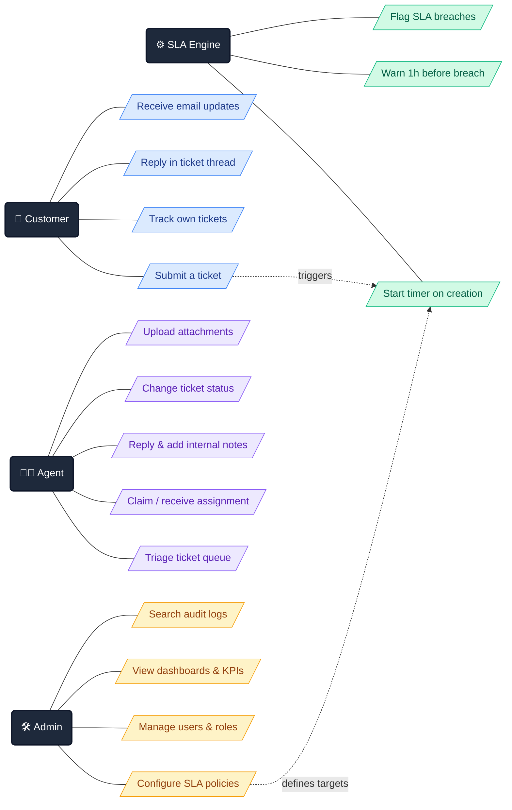

# TicketDesk Pro — Client

The **Next.js 16** frontend of TicketDesk Pro: a centralized support ticketing & SLA platform that turns a chaotic shared inbox into a disciplined customer-service workflow.

> Backend API: [`TicketDeskPro-API`](https://github.com/morshedmilton/TicketDeskPro-API) · ASP.NET Core 10 · PostgreSQL · Redis · SignalR

---

## The Story: Why This Project Exists

Picture a **20-person company with a few thousand customers** and a **3–4 person support team**. Like most small businesses, they run support out of a single shared mailbox — `support@company.com`. It works… until it doesn't.

### 😵 The problem with a shared inbox

**Emails get lost.** Hundreds of messages pile up daily. A new flood of requests buries yesterday's urgent issue, and it silently disappears.

**Nobody owns anything.** Four agents share one inbox, so no one can tell who is handling what. Two agents sometimes answer the same customer separately — with different solutions.

**No accountability.** A customer reported a critical issue three days ago and it is still hanging. The manager has no way to see who resolved how many tickets, who is underperforming, or which customers have been waiting the longest.

### ✅ What TicketDesk Pro does about it

TicketDesk Pro replaces the shared inbox with **structured, trackable, enforceable workflow**:

**Tickets** — the moment a customer reports a problem ("my password doesn't work"), the system creates a unique, numbered case file: **TKT-1001**. Every conversation, screenshot and decision lives inside that ticket — like a Messenger chat, but organized and permanent.

**Automatic assignment** — each ticket lands on a specific agent's dashboard. Everyone sees exactly what they own; work never overlaps or falls through the cracks.

**Status workflow** — a ticket moves through clear states: `Open → In Progress → Awaiting Customer → Resolved → Closed`. The full history of who changed what, and when, is always one click away.

### ⏱️ SLA: promises with a stopwatch attached

**SLA (Service Level Agreement)** is a formal time commitment to the customer. For example:

| Priority | First response within | Resolution within |
|---|---|---|
| 🔴 Urgent | 30 minutes | 4 hours |
| 🟠 High | 2 hours | 8 hours |
| 🟡 Medium | 4 hours | 24 hours |
| 🟢 Low | 8 hours | 72 hours |

The moment a ticket is created, a **digital stopwatch** starts in the background:

- 🟡 **1 hour before the deadline** — a yellow warning lights up on the agent's dashboard.
- 🔴 **Deadline passed** — the ticket turns red, gets flagged **SLA Breached**, and management is alerted automatically.

Nothing gets forgotten, because the system never stops watching.

### 🎯 Who is this for?

**SMBs (Small & Medium Businesses)** — companies with 10–100 employees. Enterprise tools like Zendesk or Freshdesk can do this job, but their monthly licensing is expensive and their feature sets are overkill. Small teams end up suffering on free email or spreadsheets instead.

TicketDesk Pro is an **affordable, self-hostable** alternative: run it on your own server, own your data, pay nothing but hosting.

---

## Use Cases at a Glance

---

## The Stack

| Layer | Technology |
|---|---|
| Framework | Next.js 16 (App Router) + TypeScript |
| Styling | Tailwind CSS + shadcn/ui |
| Real-time | SignalR WebSocket client |
| HTTP | Axios with auto token-refresh interceptors |
| Hosting | Vercel |

## Building in Public — Roadmap

- [x] Phase 1 — Database design & EF Core migrations *(API repo)*
- [x] Phase 2 — JWT auth, refresh-token rotation, RBAC *(API repo)*
- [ ] Phase 3 — Ticket management & state machine
- [ ] Phase 4 — SLA engine + real-time notifications
- [ ] Phase 5 — Dashboards & analytics
- [ ] **Phase 6 — This repo: frontend auth & layout**
- [ ] Phase 7 — Frontend tickets & dashboard UI
- [ ] Phase 8 — Production deployment (Render + Vercel)

## License

Private project — all rights reserved.
