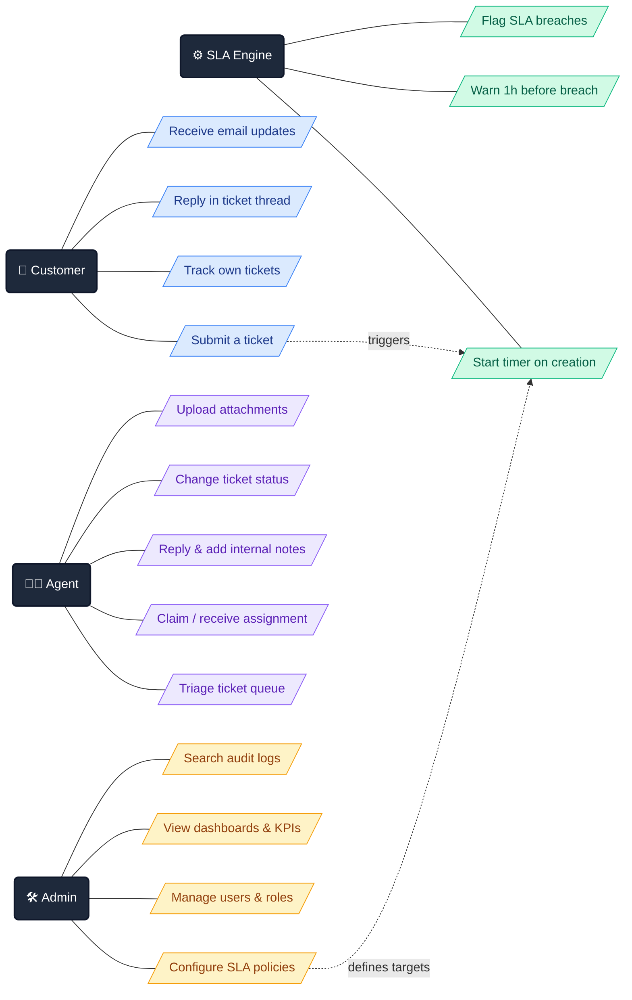
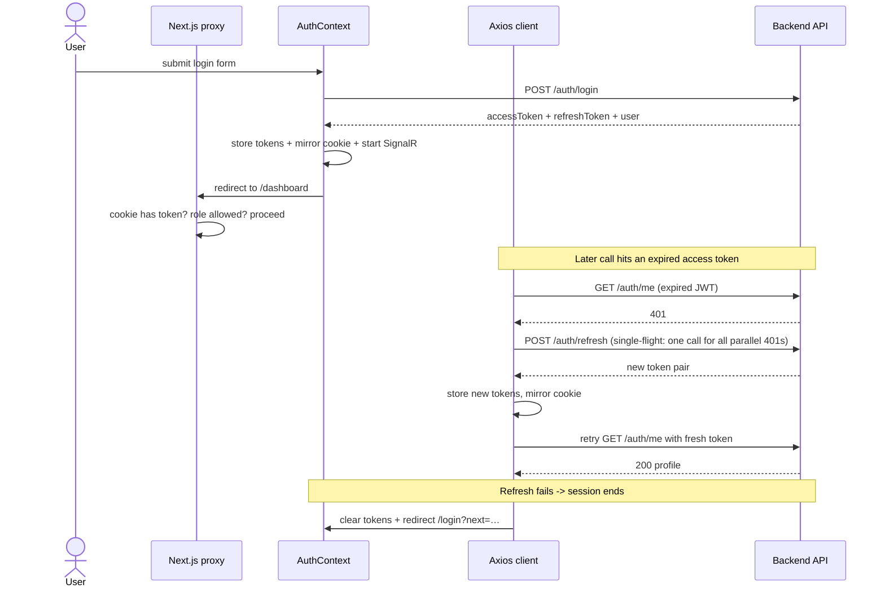
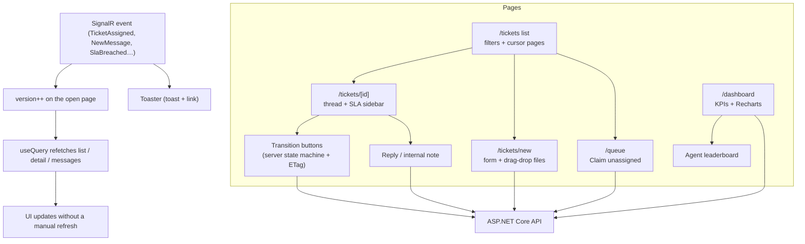

# TicketDesk Pro — Client

🚀 **Live:** https://ticketdeskpro-client.vercel.app · API: https://ticketdeskpro-api.onrender.com/swagger

The **Next.js 16** frontend of TicketDesk Pro: a centralized support ticketing & SLA platform that turns a chaotic shared inbox into a disciplined customer-service workflow.

> Backend API: [`TicketDeskPro-API`](https://github.com/morshedmilton/TicketDeskPro-API) · ASP.NET Core 10 · PostgreSQL · Redis · SignalR

---

## The Story: Why This Project Exists

Picture a **20-person company with a few thousand customers** and a **3–4 person support team**. Like most small businesses, they run support out of a single shared mailbox — `support@company.com`. It works… until it doesn't.

### 😵 The problem with a shared inbox

**Emails get lost.** Hundreds of messages pile up daily. A new flood of requests buries yesterday's urgent issue, and it silently disappears.

**Nobody owns anything.** Four agents share one inbox, so no one can tell who is handling what. Two agents sometimes answer the same customer separately — with different solutions.

**No accountability.** A customer reported a critical issue three days ago and it is still hanging. The manager has no way to see who resolved how many tickets, who is underperforming, or which customers have been waiting the longest.

### ✅ What TicketDesk Pro does about it

TicketDesk Pro replaces the shared inbox with **structured, trackable, enforceable workflow**:

**Tickets** — the moment a customer reports a problem ("my password doesn't work"), the system creates a unique, numbered case file: **TKT-1001**. Every conversation, screenshot and decision lives inside that ticket — like a Messenger chat, but organized and permanent.

**Automatic assignment** — each ticket lands on a specific agent's dashboard. Everyone sees exactly what they own; work never overlaps or falls through the cracks.

**Status workflow** — a ticket moves through clear states: `Open → In Progress → Awaiting Customer → Resolved → Closed`. The full history of who changed what, and when, is always one click away.

### ⏱️ SLA: promises with a stopwatch attached

**SLA (Service Level Agreement)** is a formal time commitment to the customer. For example:

| Priority | First response within | Resolution within |
|---|---|---|
| 🔴 Urgent | 30 minutes | 4 hours |
| 🟠 High | 2 hours | 8 hours |
| 🟡 Medium | 4 hours | 24 hours |
| 🟢 Low | 8 hours | 72 hours |

The moment a ticket is created, a **digital stopwatch** starts in the background:

- 🟡 **1 hour before the deadline** — a yellow warning lights up on the agent's dashboard.
- 🔴 **Deadline passed** — the ticket turns red, gets flagged **SLA Breached**, and management is alerted automatically.

Nothing gets forgotten, because the system never stops watching.

### 🎯 Who is this for?

**SMBs (Small & Medium Businesses)** — companies with 10–100 employees. Enterprise tools like Zendesk or Freshdesk can do this job, but their monthly licensing is expensive and their feature sets are overkill. Small teams end up suffering on free email or spreadsheets instead.

TicketDesk Pro is an **affordable, self-hostable** alternative: run it on your own server, own your data, pay nothing but hosting.

---

## Use Cases at a Glance

---

## The Stack

| Layer | Technology |
|---|---|
| Framework | Next.js 16 (App Router) + TypeScript |
| Styling | Tailwind CSS + shadcn/ui |
| Real-time | SignalR WebSocket client |
| HTTP | Axios with auto token-refresh interceptors |
| Hosting | Vercel |

## Phase 6 — Auth & Core Layout (shipped)

The full authentication loop: login/register/forgot-password pages with per-role demo buttons, an Axios client that attaches the JWT and **silently refreshes expired tokens** (single-flight — ten parallel 401s trigger exactly one refresh), a Next.js proxy guarding routes by role claims, a role-based sidebar, a live SignalR notification bell, and the app shell.

**Local dev:** start the API (`dotnet run`, enables CORS for `http://localhost:3000`), then `npm run dev` and open http://localhost:3000 — sign in with any seeded demo button.

**Design system:** `design-system/ticketdesk-pro/MASTER.md` (trust-blue primary, orange CTA, Plus Jakarta Sans) — generated from the project's UI/UX ruleset; every phase's UI must follow it.

## Phase 7 — Tickets & Dashboard UI (shipped)

The whole product surface, on top of the Phase 6 shell:

- **Ticket list** — server-driven filters (status, priority, category, assignment), cursor pagination, debounced search, auto-refresh on real-time events.
- **Ticket detail** — conversation thread with internal notes, SLA countdown bar, state-machine transition buttons (customers only get the BR-016 *Customer Replied* move), assignment, metadata editing (Open/In Progress only), attachments with drag-drop upload (BR-009/010) and download.
- **Create ticket** — validated form + dropzone; upload failures never block ticket creation (M9).
- **Queue** — unassigned open tickets with one-click **Claim** (assign self → In Progress), guarded by the ETag row version.
- **Dashboard** — role-aware: customers see personal counts; agents/admins get KPI cards, priority/trend/category charts (Recharts) and the 30-day agent leaderboard.
- **Admin pages** — users (invite/edit/deactivate/restore), SLA policies, categories & tags; plus the audit-log viewer with before/after snapshots.
- **Real-time** — SignalR events raise toasts and bump a version counter that refetches every query on the page.

## Live & Demo Logins

Deployed on **Vercel** (frontend) + **Render** (API) with **Neon** Postgres and **Upstash** Redis — all free tier. Open the app, click a demo button, password is pre-filled:

| Role | Email |
|---|---|
| SuperAdmin | superadmin@ticketdesk.dev |
| Admin | admin@ticketdesk.dev |
| Agent | agent@ticketdesk.dev |
| Customer | customer@ticketdesk.dev |

Password for all: `Admin123!`

Demo buttons show automatically in local dev; in production they appear only when the host opts in with `NEXT_PUBLIC_SHOW_DEMO_LOGIN=true` on Vercel (mirrors the API's `SeedDemoUsers` flag — demo logins are never implicit in prod).

## Building in Public — Roadmap

- [x] Phase 1 — Database design & EF Core migrations *(API repo)*
- [x] Phase 2 — JWT auth, refresh-token rotation, RBAC *(API repo)*
- [x] Phase 3 — Ticket management & state machine *(API repo)*
- [x] Phase 4 — SLA engine + real-time notifications *(API repo)*
- [x] Phase 5 — Dashboards & analytics *(API repo — backend complete)*
- [x] **Phase 6 — This repo: frontend auth & layout**
- [x] **Phase 7 — This repo: frontend tickets & dashboard UI**
- [x] **Phase 8 — Production deployment (Render + Vercel)**

## License

Private project — all rights reserved.
